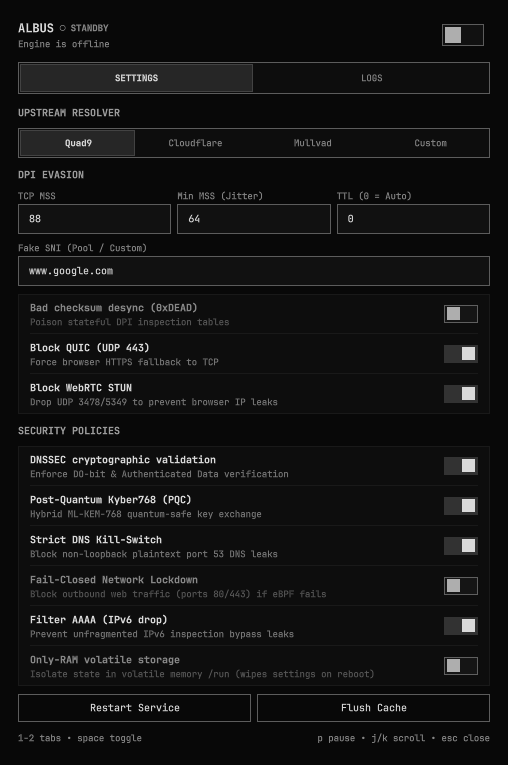
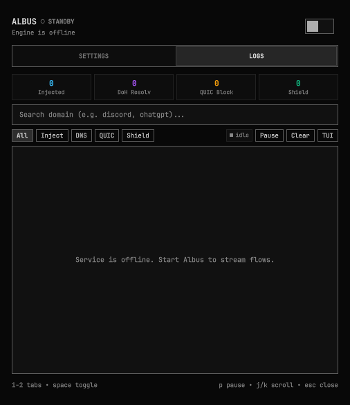

# Omarchy desktop panel

First-party [Omarchy](https://omarchy.org) Quattro widget (`Albus DPI`,
`io.github.oqullcan.albus.dev`): bar widget + control panel with live packet
telemetry, one-click resolver switching (Quad9 / Cloudflare / Mullvad),
security toggles, and keyboard shortcuts (`1`–`2` tabs, `Space` toggle,
`P` pause, `J`/`K` scroll).

Plugin store page:
<https://plugins.omarchy.org/plugin.html?id=io.github.oqullcan.albus.dev>

<p align="center">
  
  
</p>

## Install

```bash
mkdir -p ~/.config/omarchy/plugins/io.github.oqullcan.albus.dev
cp plugins/omarchy/manifest.json plugins/omarchy/BarWidget.qml plugins/omarchy/Panel.qml ~/.config/omarchy/plugins/io.github.oqullcan.albus.dev/
omarchy-shell shell rescanPlugins
```

Source files live under `plugins/omarchy/` (`manifest.json`, `BarWidget.qml`,
`Panel.qml`, `assets/`).

## Removal

```bash
omarchy plugin remove io.github.oqullcan.albus.dev
```

This deletes only the plugin directory. Daemon, binary, and config persist —
full teardown:

```bash
sudo albus service uninstall
sudo albus cleanup
omarchy plugin remove io.github.oqullcan.albus.dev
```
